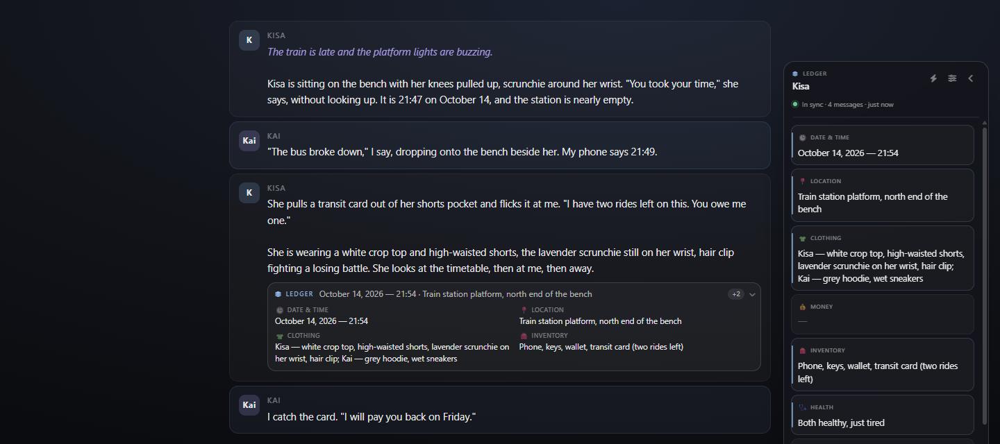
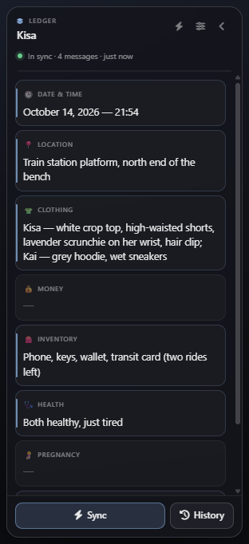
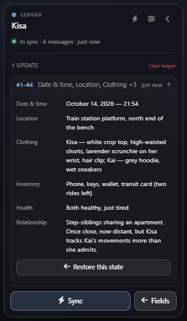
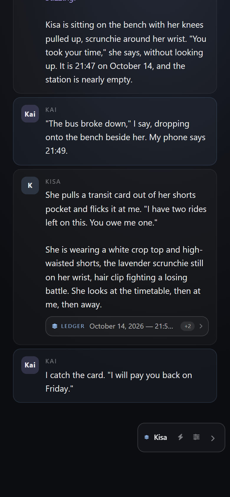
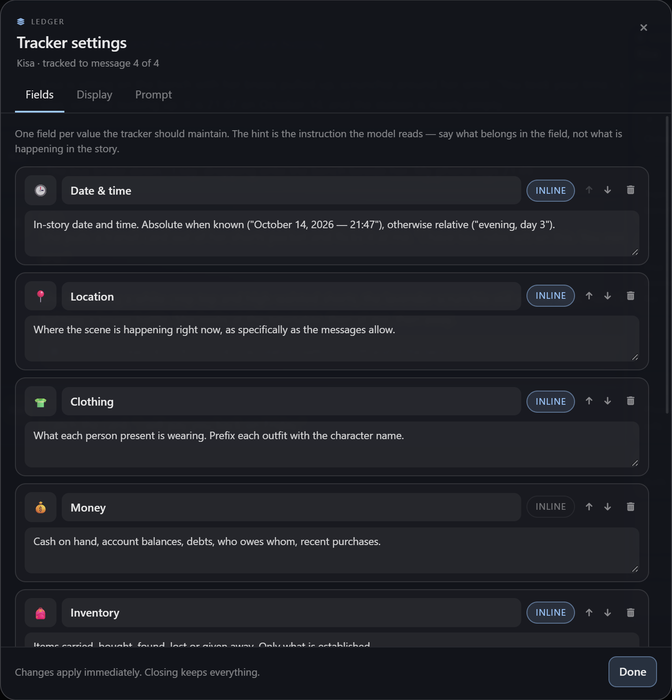

<div align="center">

# Ledger

**A live status tracker for SillyTavern — the time, the place, the clothes, the money, kept current in a panel instead of a paragraph.**




</div>

---

## The problem

A character card is written once. The story is not.

By message thirty, the reply that says *"she pulls her coat tighter against the rain"* contradicts the beach in the last scene, the twenty credits you spent three replies ago, and the fact that it is now 22:10 and the last train left at 21:58. So the usual fix is to paste a status block into the author's note and hope the model rewrites it in the same shape every turn.

What you get is a wall of bold text bolted onto the end of every reply:

> **Current Status**
> **Date & Time:** October 14 — 21:47 · **Location:** Train station platform · **Clothing:** Kisa — white crop top, high-waisted shorts… · **Money:** not established · **Inventory:** phone, keys, wallet · **Health:** healthy · **Relationship:** step-siblings, once close…

It is unreadable at a glance, identical on every message, and it drifts — because the model re-invents the block from scratch each time it writes one. Nothing keeps the old values, nothing notices when they change, and nothing can put them back.

**Ledger reads only the messages it has not read yet, keeps the fields you choose, and shows them where you can actually see them.**

## What it does

- **Reads the unread tail, not the chat.** A per-chat cursor remembers how far the tracker has scanned. Every *N* new messages it sends the model those messages plus the current values, and asks for a diff — only the fields that changed. Edits and swipes rewind the cursor by one message, so a regenerated reply is re-read instead of skipped.
- **The fields are yours.** Time, place, clothing, money, inventory, health, pregnancy, relationship ship as defaults; rename them, change the hint the model reads, reorder them, or delete them and add your own. Any field can be marked inline.
- **Two places to see it.** A floating panel (drag it by the header, minimise it to a pill) with the full ledger, per-field edit, per-field lock, and a history of every change with one-click restore. And a compact block under the newest reply — rendered in the DOM, **never inside the message text**, so your chat exports and edits stay clean.
- **Feeds it back.** The ledger is injected into every generation through `setExtensionPrompt` — inside the chat history at a depth you choose, or in the prompt — with an editable template. That is the part that stops the contradictions.
- **Fails loudly, not silently.** If the model returns something that is not a status object, the panel says so and the cursor stays put. No messages are ever lost to a bad reply.
- **No extra backend.** It uses your existing connection through `generateQuietPrompt`, with the sampling you already configured.

## Screenshots

<div align="center">

<br><em>The panel. Values change in place; a field you change yourself can be locked against the next scan.</em>
</div>

<div align="center">

<br><em>History: every scan that changed something, with what it changed and a way back.</em>
</div>

<div align="center">

<br><em>On a phone the panel starts as a pill and the block stays under the reply.</em>
</div>

## Settings

<div align="center">

</div>

| Where | What you can set |
|---|---|
| **Extension drawer** | Sync automatically on/off, every *N* new messages, open the tracker settings |
| **Panel** | Scan now / stop, history, clear, minimised pill, drag position |
| **Settings → Fields** | Icon, label, the hint the model reads, inline on/off, order, add, delete, reset to defaults |
| **Settings → Display** | Show the block under the reply, start collapsed, show icons, grid or list layout, panel open on load, reset position |
| **Settings → Prompt** | Inject on/off, position (in chat / in prompt), depth, editable template with `{{state}}`, live preview, old block stripping, batch size, characters per message, toast on update |

### Fields that ship by default

| Field | Hint the model reads |
|---|---|
| 🕒 Date & time | In-story date and time, absolute when known, otherwise relative |
| 📍 Location | Where the scene is happening right now |
| 👕 Clothing | What each person present is wearing, prefixed with their name |
| 💰 Money | Cash, balances, debts, recent purchases |
| 🎒 Inventory | Items carried, bought, found, lost or given away |
| 🩺 Health | Injuries, illness, exhaustion, physical condition |
| 🤰 Pregnancy | Only if the story tracks it — never guessed |
| 💞 Relationship | Status between the characters and any shift in it |

## How it works

| Question | Answer |
|---|---|
| Which model call? | `generateQuietPrompt` — the active card, persona and world info stay in context, your connection and presets are used. 600 tokens per batch. |
| What does it send? | The field ids and hints, the current JSON values, and the transcript of the unread messages (trimmed to *characters per message*, batches of *N* messages). |
| What comes back? | One JSON object between `<<<LEDGER>>>` and `<<<END>>>`, containing **only the fields that changed**. `{}` means nothing happened. |
| What does it write? | `chatMetadata['st-ledger']` — values, locks, cursor, the signature of the last scanned message, and up to 60 history snapshots. Nothing is written to the character card or the messages. |
| What does it inject? | `setExtensionPrompt('st-ledger-state', …)` at your chosen position and depth, rebuilt whenever a value changes. |
| When does it run? | After a reply when the unread count reaches *N*, on edit/swipe of the last message, and on demand from the panel or `/ledger scan`. |

Two guards worth knowing about: a scanned message is fingerprinted (name, role, text length, hash), so a rewritten last message is detected and re-read; and a reply that cannot be parsed aborts the scan without moving the cursor.

## Install

**From the repository** — *Extensions* → *Install Extension* → paste the repo URL:

```
https://github.com/HakaiGod420/st-ledger
```

**Manually** — unzip into:

```
SillyTavern/public/scripts/extensions/third-party/st-ledger/
```

then reload SillyTavern. The panel appears on the right; drag it by its header, or find *Ledger* in the wand menu.

**First run:** open a chat and press **Sync** (or `/ledger scan`). The first scan reads the tail of the chat in batches of twelve messages; a long chat asks before spending more than one generation.

## Slash commands

| Command | Effect |
|---|---|
| `/ledger` | Print the current ledger as text |
| `/ledger sync` | Scan one batch of unread messages |
| `/ledger scan` | Scan everything unread, in batches |
| `/ledger clear` | Forget all values and start from the first message |

## Compatibility notes

- Built against the SillyTavern 1.12+ extension API: `getContext`, `chatMetadata`, `setExtensionPrompt`, `generateQuietPrompt`, `Popup`.
- Uses your theme through `--SmartTheme*` variables, so it follows dark, light and custom themes without a second stylesheet.
- One ledger per chat: switching chats loads that chat's state; duplicating a chat carries its ledger with it.
- Group chats: the transcript labels every speaker, but the fields describe the scene rather than one card.

## Licence

MIT — see [LICENSE](LICENSE).
